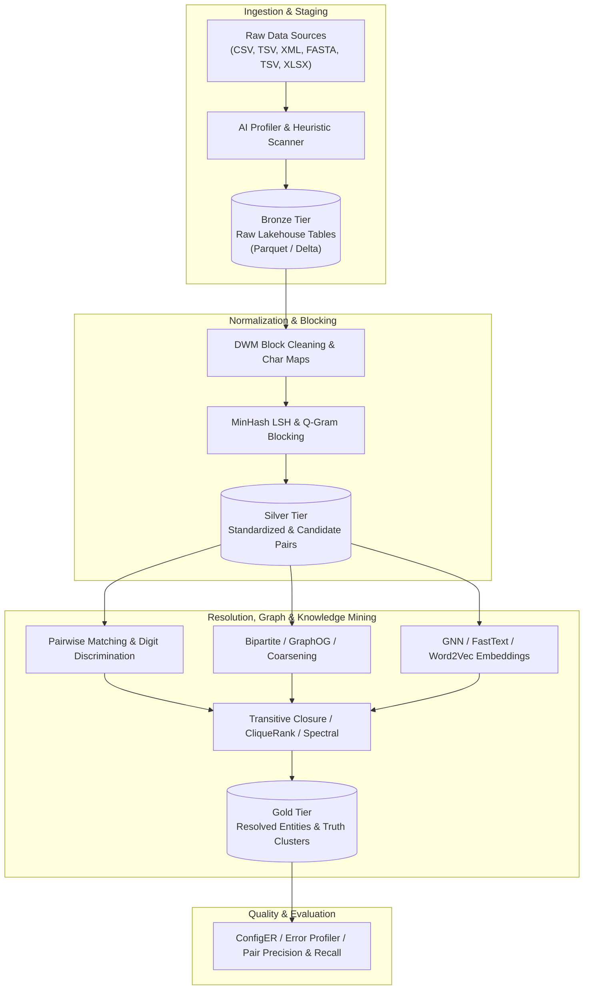

# Data Integration Toolkit (DITK)

[](https://www.python.org/downloads/)
[](https://opensource.org/licenses/MIT)
[](#medallion-storage-architecture)
[](#running-tests--validation)

A unified, high-performance Lakehouse Engine for **Scalable Entity Resolution (ER)**, **Graph Representation Learning (GNN & GraphOG)**, **Biomedical NLP Knowledge Integration**, and **Bioinformatics Proteomics** built on a tiered Medallion storage model (Bronze $\to$ Silver $\to$ Gold).

---

## Table of Contents

- [Overview & Architecture](#overview--architecture)
- [Medallion Storage Architecture](#medallion-storage-architecture)
- [Key Subsystems & Capabilities](#key-subsystems--capabilities)
  - [1. Classical & Modern Entity Resolution (DWM & GER)](#1-classical--modern-entity-resolution-dwm--ger)
  - [2. Graph Representation & GNN Embedding Engine](#2-graph-representation--gnn-embedding-engine)
  - [3. Biomedical NLP & Knowledge Graph Integration](#3-biomedical-nlp--knowledge-graph-integration)
  - [4. Bioinformatics & Proteomics (ProtGram)](#4-bioinformatics--proteomics-protgram)
  - [5. Synthetic Population & Error Generation (SOG Mimic)](#5-synthetic-population--error-generation-sog-mimic)
  - [6. Declarative Lakehouse SQL Engine](#6-declarative-lakehouse-sql-engine)
  - [7. AI-Driven Ingestion Profiler & Interactive Router](#7-ai-driven-ingestion-profiler--interactive-router)
- [Benchmark & Research Datasets Catalog](#benchmark--research-datasets-catalog)
- [Repository Structure](#repository-structure)
- [Installation & Requirements](#installation--requirements)
- [Quickstart Guide](#quickstart-guide)
  - [Python Lakehouse API](#python-lakehouse-api)
  - [Interactive Lakehouse CLI](#interactive-lakehouse-cli)
  - [Interactive AI Profiling Usecases](#interactive-ai-profiling-usecases)
- [Running Tests & Validation](#running-tests--validation)

---

## Overview & Architecture

The **Data Integration Toolkit (DITK)** unifies disparate entity matching algorithms, NLP parsers, graph embedding frameworks, and bioinformatics tools into a single modular Lakehouse environment. It replaces ad-hoc data preparation scripts with declarative pipelines, automated data profiling, robust out-of-core streaming, and columnar storage.



---

## Medallion Storage Architecture

The toolkit enforces a strict, reproducible Lakehouse Medallion architecture managed by [`StorageManager`](file:///g:/My%20Drive/Workspace/Research/Code/Internal/DATA-ENGINEERING/DataIntegrationToolkit/src/storage/fs.py) and [`LakehouseCatalog`](file:///g:/My%20Drive/Workspace/Research/Code/Internal/DATA-ENGINEERING/DataIntegrationToolkit/src/catalog/catalog.py):

| Tier | Directory | Format | Purpose & Provenance |
| :--- | :--- | :--- | :--- |
| **Bronze** | `lakehouse/bronze/` | Apache Parquet / Delta | Raw ingested tables preserving original schemas, record IDs, and source provenance without lossy transformations. |
| **Silver** | `lakehouse/silver/` | Apache Parquet / Delta | Cleaned, normalized, and partitioned candidate pair blocks, normalized character mappings, and intermediate bipartite matrices. |
| **Gold** | `lakehouse/gold/` | Apache Parquet / Delta | Final resolved entity clusters, connected components, graph embeddings, coarsened biological networks, and evaluation benchmark matrices. |

---

## Key Subsystems & Capabilities

### 1. Classical & Modern Entity Resolution (DWM & GER)
Located in [`src/operators/silver.py`](file:///g:/My%20Drive/Workspace/Research/Code/Internal/DATA-ENGINEERING/DataIntegrationToolkit/src/operators/silver.py), [`src/operators/gold.py`](file:///g:/My%20Drive/Workspace/Research/Code/Internal/DATA-ENGINEERING/DataIntegrationToolkit/src/operators/gold.py), and [`src/operators/eval.py`](file:///g:/My%20Drive/Workspace/Research/Code/Internal/DATA-ENGINEERING/DataIntegrationToolkit/src/operators/eval.py):
- **DWM Block Cleaning (`BlockCleanerOperator`)**: Purges oversized, non-informative blocks via dynamic frequency thresholds, token weighting, and reference dictionaries.
- **Character Normalization (`CharacterMapsOperator`)**: Maps multi-language, phonetic, and non-ASCII character variations into deterministic canonical forms.
- **21-Feature Comparator with Digit Discrimination (`RecordFeatureComparatorOperator`)**: Computes 21 string, phonetic, token, and numeric similarity features, incorporating strict digit discrimination to prevent false matches on addresses, phone numbers, and codes.
- **Graph Entity Profiling & Entropy (`ClusterEntropyCalculator`)**: Measures cluster homogeneity, purity, and Shannon entropy over multi-attribute entity distributions.
- **Graph-based Entity Resolution (GER)**:
  - **Bipartite Graph Construction (`BipartiteGraphConstructor`)**: Builds entity-token and entity-attribute bipartite networks.
  - **CliqueRank & HITS (`CliqueRankOperator`, `HITSOperator`)**: Ranks candidate entity pairs by authority and hub centrality scores.
  - **Spectral Graph Partitioning**: Computes the Fiedler vector and leading eigenvectors of normalized graph Laplacians for community discovery.
  - **BRIM (Bipartite Recursively Induced Modules)**: Bipartite modularity maximization for modular entity grouping.
- **Transitive Closure (`TransitiveClosureOperator`, `GraphOGAlgorithms`)**: Supports Talburt-Wang transitive closure, Quick Connected Components, and BFS random walks.

### 2. Graph Representation & GNN Embedding Engine
Located in [`src/operators/gnn.py`](file:///g:/My%20Drive/Workspace/Research/Code/Internal/DATA-ENGINEERING/DataIntegrationToolkit/src/operators/gnn.py):
- **Text & Node Vectorization**: Word2Vec, Doc2Vec, and FastText embedding operators.
- **Levy & Goldberg PPMI-SVD Fallback**: Zero-dependency mathematical fallback computing Positive Pointwise Mutual Information (PPMI) with Truncated SVD when external NLP binaries are absent.
- **Graph Neural Network Encoders (`GNNEncoderOperator`)**: Generates multi-layer Graph Convolutional Network (GCN) representations.
- **Deep Learning Data Builders**:
  - `LSTMDataBuilder`: Sequences character and token streams into padded PyTorch tensors.
  - `XGCNDataBuilder`: Formats multi-relational graphs for extreme-scale Graph Convolutional Networks.

### 3. Biomedical NLP & Knowledge Graph Integration
Located in [`src/operators/nlp.py`](file:///g:/My%20Drive/Workspace/Research/Code/Internal/DATA-ENGINEERING/DataIntegrationToolkit/src/operators/nlp.py):
- **PubMed XML Archive Parser (`PubmedExtractorOperator`)**: High-throughput extraction of citations, abstracts, mesh headings, authors, and affiliations conforming to the official PubMed DTD.
- **Biomedical NER (BioBERT & SpaCy)**: Pipeline extraction of genes, diseases, chemicals, and clinical entities with dictionary-backed fallbacks.
- **Ontology & Knowledge Graph Harmonization**: Aligns extracted entities to standard ontologies and constructs unified RDF knowledge graphs (Chem2Bio2RDF).
- **Author & Institution Profiling (`AuthorProfilerOperator`)**: Aggregates co-authorship networks, h-indices, and institutional affiliations.
- **Heterogeneous Graph Embedding (`KnowledgeGraphEmbeddingOperator`)**: Random walk embeddings (Node2Vec & MetaPath2Vec) across complex heterogeneous biological networks.

### 4. Bioinformatics & Proteomics (ProtGram)
Located in [`src/operators/bio.py`](file:///g:/My%20Drive/Workspace/Research/Code/Internal/DATA-ENGINEERING/DataIntegrationToolkit/src/operators/bio.py):
- **FASTA & UniRef Parsing (`FastaLoaderOperator`)**: Memory-efficient streaming of large FASTA and UniRef50 sequence files into structured schemas.
- **ProtGram N-Gram Tokenization & Graphing (`ProtgramOperator`)**: Translates amino acid sequences into overlapping $k$-mer graphs with positional co-occurrence weights.
- **DirectGCN Protein Representation**: Graph-level embeddings for molecular function, biological process, and cellular component prediction.
- **Graph Coarsening (`GraphCoarsenerOperator`)**: Multilevel Graclus and Heavy-Edge Matching (HEM) graph reduction, reducing graph order by up to 50% while preserving spectral topological invariants.
- **PPI Network Harmonization**: Resolves cross-database identifiers (UniProt, BioGRID, STRING) into physical protein-protein interaction networks.

### 5. Synthetic Population & Error Generation (SOG Mimic)
Located in [`src/operators/synthetic.py`](file:///g:/My%20Drive/Workspace/Research/Code/Internal/DATA-ENGINEERING/DataIntegrationToolkit/src/operators/synthetic.py):
- **Native Python Re-implementation of R `SOG mimic`**: Complete reproduction of synthetic demographic generation originally authored in R.
- **Zero-Dependency Excel Reader**: Native parsing of `.xlsx` lexicon tables (First Names, Last Names, Addresses, Nicknames) using standard ZIP and XML streaming.
- **16 Realistic Demographic Error Modes (`SyntheticErrorCorruptor`)**:
  - Typographical mutations (character insertion, deletion, replacement, transposition).
  - OCR confusion errors (e.g., `rn` $\to$ `m`, `0` $\to$ `O`, `1` $\to$ `l`).
  - Phonetic variations (e.g., `ph` $\leftrightarrow$ `f`, `c` $\leftrightarrow$ `k`, `sch` $\leftrightarrow$ `sh`).
  - Nickname transformations via reference lookup tables.
  - Value swapping (e.g., First Name $\leftrightarrow$ Last Name).
  - Street address corruption and number truncation.
  - Multi-attribute correlated error cascades.

### 6. Declarative Lakehouse SQL Engine
Located in [`src/sql/`](file:///g:/My%20Drive/Workspace/Research/Code/Internal/DATA-ENGINEERING/DataIntegrationToolkit/src/sql/):
DITK features a native SQL parser and query planner extending standard ANSI SQL with specialized Lakehouse, Entity Resolution, and Graph primitives:

```sql
-- 1. Ingest raw data into Bronze
INGEST FROM 'data/entity_resolution/restaurants/S3Rest.txt' 
INTO bronze.restaurants 
WITH (delimiter = '\t', has_header = false);

-- 2. Stage and clean into Silver
STAGE silver.staged_restaurants FROM bronze.restaurants 
WITH (columns = 'id, name, address, city, phone');

-- 3. MinHash LSH Blocking
BLOCK silver.restaurant_blocks FROM silver.staged_restaurants 
WITH (method = 'minhash_lsh', columns = 'name, address', threshold = 0.5);

-- 4. Entity Resolution into Gold
RESOLVE gold.resolved_restaurants FROM silver.restaurant_blocks 
WITH (method = 'transitive_closure', similarity_threshold = 0.85);

-- 5. Protein Sequence Graph Coarsening
COARSEN GRAPH silver.coarse_ppi FROM bronze.protein_sim 
WITH (src_col = 'f0', dst_col = 'f1', levels = 2, method = 'graclus');

-- 6. AI Ingestion Profiling & Routing
AI PROFILE FROM 'data/inbox/uniref50_sample.fasta';
AI ROUTE FROM 'data/inbox/uniref50_sample.fasta' INTO bronze.uniref_sample;
```

### 7. AI-Driven Ingestion Profiler & Interactive Router
Located in [`src/ai/`](file:///g:/My%20Drive/Workspace/Research/Code/Internal/DATA-ENGINEERING/DataIntegrationToolkit/src/ai/):
- **Universal Dataset Scanner (`DatasetScanner`)**: Inspects unlabelled files in `data/inbox/`, analyzes magic bytes, delimiters, column headers, and sample records.
- **Gemini AI Profiler (`GeminiClient`)**: Leverages Google Gemini to automatically classify incoming datasets (e.g., FASTA sequences, bibliometric citations, demographic records) and output structured processing plans.
- **Offline Heuristic Fallback**: 100% deterministic local rules ensure full functionality even without external API credentials or active internet connections.
- **Interactive Prompter**: Interactive step-by-step CLI workflows prompting users on cleaning, tokenization (n-gram vs. wordpiece), graph adjacency (sparse vs. dense), and ML label extraction.

---

## Benchmark & Research Datasets Catalog

The repository includes a curated benchmark catalog across multiple research domains located in `data/`:

```
data/
├── entity_resolution/
│   ├── restaurants/
│   │   ├── S3Rest.txt                     # 868 restaurant records (Fodor's & Zagat)
│   │   ├── S3Rest-params.txt              # Standard baseline execution parameters
│   │   ├── S3Rest-LinkIndex.txt           # Precomputed baseline cluster link index
│   │   └── truthRestaurant.txt            # Ground truth duplicate pairs / cluster mappings
│   │
│   ├── e_commerce/
│   │   ├── S23AmazonGoogle.txt            # Amazon-Google product match benchmark
│   │   ├── S23AmazonGoogle-params.txt
│   │   ├── S23AmazonGoogle-LinkIndex.txt
│   │   ├── truthAmazonGoogle.txt          # Ground truth product clusters
│   │   ├── S24AbtRakuten-params.txt       # Abt-Buy (Rakuten) benchmark parameters
│   │   ├── S24AbtRakuten-LinkIndex.txt
│   │   └── truthAbtRakuten.txt            # Ground truth product clusters
│   │
│   ├── academic_citations/
│   │   ├── S20ACMDBLP-params.txt          # ACM vs DBLP paper matching parameters
│   │   ├── S20ACMDBLP-LinkIndex.txt
│   │   ├── truthACMDBLP.txt               # Ground truth paper clusters
│   │   ├── S21DBLPGoogle.txt              # DBLP vs Google Scholar paper matching
│   │   ├── S21DBLPGoogle-params.txt
│   │   ├── truthDBLPGoogle.txt
│   │   ├── S22Affiliations.txt            # Author institution affiliation deduplication
│   │   ├── S22Affiliations-params.txt
│   │   ├── truthAffiliations.txt
│   │   ├── S25DBLPACM-2.txt               # Extended DBLP-ACM benchmark
│   │   ├── truthDBLPACM-2.txt
│   │   ├── DBLP1.csv                      # DBLP publication export
│   │   ├── Scholar.csv                    # Google Scholar publication export
│   │   └── DBLP-Scholar_perfectMapping.csv # Ground truth matching map
│   │
│   └── synthetic_demographics/
│       ├── S1G.txt                        # Clean synthetic demographics (50 records)
│       ├── S1G-params.txt
│       ├── S1G-LinkIndex.txt
│       ├── truthABCgoodDQ.txt             # Ground truth for S1G (good data quality)
│       ├── S6GeCo.txt                     # GeCo realistic demographic corruption generator
│       ├── S6GeCo-params.txt
│       ├── S6GeCo-LinkIndex.txt
│       ├── truthGeCo.txt                  # Ground truth for GeCo benchmark
│       ├── truthABCpoorDQ.txt             # Ground truth for corrupted demographic runs
│       ├── S2G - S18PX [txt, params, link] # Graded corruption series (S2G - S18PX)
│       ├── S9-By-ClusterID-Then-TrueID.txt
│       └── lexicons/
│           ├── AddressList.xlsx           # Street address reference dictionary
│           ├── FirstName_Top.xlsx         # Common first name frequency tables
│           ├── LastName_Top.xlsx          # Common last name frequency tables
│           ├── nicknames.xlsx             # Given name variant/nickname lookup dictionary
│           ├── ListB_200k.txt             # Large synthetic demographic corpus (200k)
│           └── ListB_300k.txt             # Large synthetic demographic corpus (300k)
│
├── graph_learning/
│   ├── karate_club/                       # Social network modularity & GCN benchmark
│   │   ├── karate_edges_77.txt            # Zachary's Karate Club graph edges (77 edges)
│   │   ├── karate_groups.txt              # Faction ground-truth cluster labels
│   │   ├── karate_embedding.tsv           # Baseline node embeddings
│   │   └── karate_metadata.tsv            # Node metadata & labels
│   │
│   └── entity_character_graphs/           # Representation learning & embedding graphs
│       ├── graph.txt                      # Bipartite entity-character relation graph
│       ├── character_embedding.tsv        # Character-level GCN / Skip-gram embeddings
│       ├── node_to_characters.tsv         # Graph node to character mapping
│       ├── embedding.tsv                  # Multi-relational entity vectors
│       ├── metadata.tsv                   # Metadata labels
│       ├── entity_embedding.tsv           # Entity-level node vectors
│       ├── node_to_entities.tsv           # Node to entity mapping
│       ├── record-clusters.csv            # Cluster assignments
│       └── samples.csv                    # Subsampled graph batches for training
│
├── biomedical_nlp/
│   ├── pubmed/                            # PubMed XML corpus & extraction queries
│   │   ├── pubmed23n0001.xml              # Official PubMed XML baseline archive
│   │   ├── pubmed_230101.dtd              # PubMed DTD schema definition
│   │   ├── PubMed.sql                     # Relational schema definition
│   │   └── pubmed-database-quieries.sql   # SQL extraction queries
│   │
│   ├── cancer_cohorts/                    # Cancer literature abstracts & classification
│   │   ├── Top_50_Cancer_PMIDs.txt        # PubMed IDs for curated cancer literature
│   │   ├── pos.txt                        # Positive training labels
│   │   ├── positive.txt                   # Positive cancer abstracts
│   │   └── negative.txt                   # Negative control abstracts
│   │
│   └── vocab_entities/                    # Biomedical ontologies & entity lists
│       ├── biobert-entities.txt           # BioBERT Named Entity Recognition output
│       ├── disease-list.txt               # Standard disease terminology lexicon
│       ├── drug-list.txt                  # Therapeutic drug reference list
│       └── gene-list.txt                  # Human gene symbol vocabulary
│
└── bioinformatics/                        # Molecular & sequence similarity matrices
    ├── compound_structure_similarity.txt  # Small-molecule structural similarity scores
    └── protein_sequence_similarity.txt    # Protein sequence alignment similarity scores
```

---

## Repository Structure

```
DataIntegrationToolkit/
├── src/                               # Core Lakehouse Engine package
│   ├── __init__.py                    # Public API exports & version metadata
│   ├── context.py                     # High-level LakehouseContext & IngestionContext
│   ├── cli.py                         # Interactive Lakehouse SQL CLI
│   ├── storage/
│   │   └── fs.py                      # StorageManager (Parquet & Delta Lake backend)
│   ├── catalog/
│   │   ├── catalog.py                 # LakehouseCatalog (Table registration & schemas)
│   │   └── table.py                   # TableMetadata abstraction
│   ├── operators/
│   │   ├── base.py                    # BaseOperator protocol
│   │   ├── bronze.py                  # Batch & out-of-core ingestion
│   │   ├── silver.py                  # Staging, MinHash LSH, DWM block cleaning
│   │   ├── gold.py                    # Transitive closure, GER, CliqueRank, HITS
│   │   ├── gnn.py                     # Word2Vec, FastText, GNN encoders, LSTM builders
│   │   ├── nlp.py                     # PubMed XML extractor, BioBERT NER, KG walks
│   │   ├── bio.py                     # ProtGram, amino acid n-grams, graph coarsening
│   │   ├── eval.py                    # Precision, Recall, F1, ConfigER, Error Profiler
│   │   ├── synthetic.py               # SOG Mimic demographic generator & corruptor
│   │   └── dask_engine.py             # Dask out-of-core streaming partition engine
│   ├── sql/
│   │   ├── ast.py                     # SQL Abstract Syntax Tree nodes
│   │   ├── parser.py                  # Recursive-descent Lakehouse SQL parser
│   │   └── planner.py                 # Logical & physical query execution planner
│   └── ai/
│       ├── scanner.py                 # File format, delimiter, & structure scanner
│       ├── gemini_client.py           # Gemini API client & heuristic fallback
│       └── router.py                  # Automated ingestion & profiling planner
│
├── toolkit/                           # Backward-compatibility alias shim
│   └── __init__.py                    # Redirects 'toolkit.*' imports to 'src.*'
│
├── data/                              # Benchmark & research datasets catalog
├── examples/                          # End-to-end reproducible pipelines
│   ├── run_pubmed_usecase.py          # PubMed XML to Chem2Bio2RDF KG workflow
│   └── run_uniref_ngram_usecase.py    # Interactive UniRef50 AI profiling & n-gram pipeline
│
├── tests/                             # Comprehensive test suite (37 tests)
│   ├── test_lakehouse_core.py         # Storage, catalog, and basic SQL tests
│   ├── test_evaluator.py              # Precision, recall, and benchmark tests
│   ├── test_gnn_representation.py     # GNN encoders, FastText, Word2Vec SVD
│   ├── test_biomedical_nlp.py         # PubMed extraction & KG embedding tests
│   ├── test_bioinformatics.py         # FASTA ingestion, ProtGram, graph coarsening
│   ├── test_scalability.py            # Dask out-of-core partitioning tests
│   ├── test_ai_profiler.py            # AI dataset scanner & router tests
│   ├── test_refactored_src.py         # DWM classical ER, GER, CliqueRank, HITS
│   ├── test_synthetic_generator.py    # SOG Mimic demographic generation & error modes
│   └── test_uniref_ngram.py           # UniRef amino acid n-gram graph tests
│
└── README.md                          # Primary project documentation
```

---

## Installation & Requirements

### System Requirements
- Python 3.10+ (tested on Python 3.10, 3.11, 3.12, 3.13, 3.14)
- Platform: Windows 10/11, Ubuntu / Debian / WSL2, macOS

### Dependencies
Install the required scientific, graph, and data processing dependencies:

```bash
pip install pandas numpy scipy networkx pyarrow dask pytest
```

*Optional acceleration dependencies*:
```bash
pip install torch gensim google-genai
```

> **Note**: External packages such as `gensim`, `torch`, or `google-genai` are completely optional. The toolkit provides built-in, zero-dependency pure-Python / NumPy / SciPy mathematical fallbacks (e.g. PPMI-SVD for word vectors, deterministic heuristic classification for AI profiling).

---

## Quickstart Guide

### Python Lakehouse API

```python
from src.context import LakehouseContext

# Initialize Lakehouse with storage directory
ctx = LakehouseContext(lakehouse_root="./lakehouse")

# 1. Ingest raw restaurant data into Bronze
ctx.sql("""
    INGEST FROM 'data/entity_resolution/restaurants/S3Rest.txt'
    INTO bronze.restaurants
    WITH (delimiter = '\t', has_header = false);
""")

# 2. Stage attributes into Silver
ctx.sql("""
    STAGE silver.staged_restaurants
    FROM bronze.restaurants
    WITH (columns = 'id, name, address, city, phone');
""")

# 3. Block using MinHash LSH
ctx.sql("""
    BLOCK silver.blocks
    FROM silver.staged_restaurants
    WITH (method = 'minhash_lsh', columns = 'name, address', threshold = 0.5);
""")

# 4. Resolve entities into Gold clusters
res = ctx.sql("""
    RESOLVE gold.resolved_restaurants
    FROM silver.blocks
    WITH (method = 'transitive_closure', similarity_threshold = 0.85);
""")

print(f"Resolved {res.num_rows} records into clusters!")
```

### Interactive Lakehouse CLI

Launch the interactive SQL shell:

```bash
python src/cli.py
```

```text
================================================================================
  DATA INTEGRATION TOOLKIT (DITK) - LAKEHOUSE INGESTION SQL SHELL
  Type SQL statements ending with ';'. Type 'exit;' or 'quit;' to exit.
================================================================================
lakehouse> SHOW TABLES;
schema | table_name         | format  | rows
-------+--------------------+---------+-----
bronze | restaurants        | parquet | 868
silver | staged_restaurants | parquet | 868
gold   | resolved_clusters  | parquet | 752
lakehouse> quit;
```

### Interactive AI Profiling Usecases

Run the interactive AI profiler on unlabelled input datasets:

```bash
python examples/run_uniref_ngram_usecase.py
```

The CLI inspects the dataset, presents an AI-generated profiling recommendation, and guides the user step-by-step through:
1. Sequence cleaning and non-standard residue normalization.
2. Duplicate entity resolution.
3. Tokenization mode selection ($k$-mer n-gram vs. WordPiece).
4. Feature generation (TF-IDF vs. Bag-of-Words).
5. Graph adjacency computation (Sparse SciPy CSR vs. Dense NumPy).

---

## Running Tests & Validation

The test suite validates all Lakehouse tiers, operators, algorithms, and models across 37 automated tests:

### Running on Linux / WSL2:
```bash
pytest tests/
```

### Running on Windows:
```bash
python -m unittest discover tests/
```

```text
============================== test session starts ==============================
collected 37 items

tests/test_ai_profiler.py ....                                            [ 10%]
tests/test_bioinformatics.py ..                                           [ 16%]
tests/test_biomedical_nlp.py .                                            [ 18%]
tests/test_evaluator.py ...                                               [ 27%]
tests/test_gnn_representation.py ...                                      [ 35%]
tests/test_lakehouse_core.py ...                                          [ 43%]
tests/test_refactored_src.py ........                                     [ 64%]
tests/test_scalability.py ...                                             [ 72%]
tests/test_synthetic_generator.py ....                                    [ 83%]
tests/test_track2_gnn.py .                                                [ 86%]
tests/test_track3_bio.py .                                                [ 89%]
tests/test_track4_nlp.py .                                                [ 91%]
tests/test_track6_scalability.py .                                        [ 94%]
tests/test_uniref_ngram.py ..                                             [100%]

======================== 37 passed, 1 warning in 30.32s ========================
```

---

## License

This project is licensed under the MIT License.
